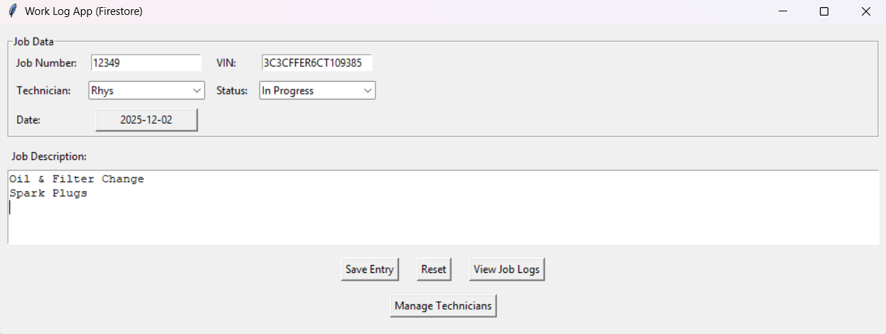
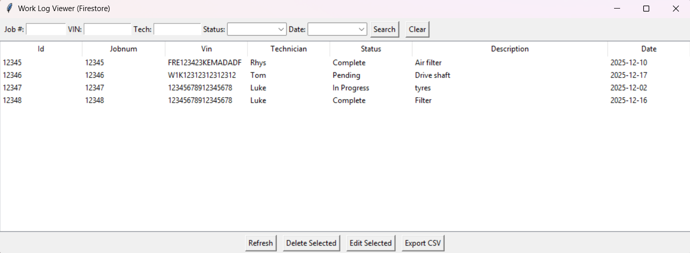
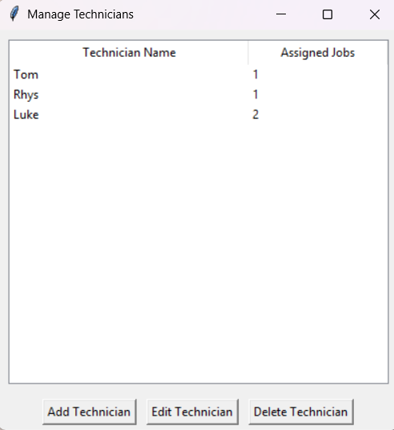

# Auto Work Log 🛠️

A Python desktop application for managing automotive workshop jobs, vehicles, and technician assignments.

I built the project around a workflow I understood from the automotive industry, with two storage implementations: a local SQLite version and a cloud-backed Firebase/Firestore version.

## Screenshots

### Main job form


### Job log viewer


### Technician management


### Vehicle management


## Features

### Firestore version (`main.py`)

- Create workshop jobs and assign them to technicians
- Manage vehicle records
- Manage technician records
- Track job status: Pending, In Progress, or Complete
- Edit and delete existing jobs
- View job history in a table
- Export displayed jobs to CSV
- Store jobs, vehicles, and technicians in Firebase Firestore

### Local SQLite version (`main_sql.py`)

- Local SQLite database setup
- Create, edit, and delete work-log entries
- Technician management
- Search/filter job records
- Sort table columns
- CSV import and export
- Input validation for job numbers and VINs

## Tech stack

- Python
- Tkinter / ttk
- SQLite
- Firebase Admin SDK / Firestore
- tkcalendar
- CSV import/export

## Project structure

```text
Auto-work-log-app/
├── main.py             # Firebase / Firestore version
├── main_sql.py         # Local SQLite version
├── requirements.txt
├── screenshots/
└── README.md
```

## Installation

```bash
git clone https://github.com/lukeacko/Auto-work-log-app.git
cd Auto-work-log-app
python -m venv .venv
```

Activate the virtual environment, then install dependencies:

```bash
pip install -r requirements.txt
```

> Tkinter ships with standard Python on Windows and macOS. Some Linux distributions require the OS package for Tkinter to be installed separately.

## Run the local SQLite version

The quickest way to try the project is the local version:

```bash
python main_sql.py
```

The application creates `worklogs.db` locally. The database file is excluded from Git.

## Run the Firestore version

1. Create a Firebase project and enable Firestore.
2. Create a Firebase service-account key.
3. Save the downloaded credential file as `serviceAccount.json` in the repository root.
4. Run:

```bash
python main.py
```

**Never commit `serviceAccount.json` to Git.** It is included in `.gitignore`.

## What I learned

This project gave me practical experience taking a real workshop workflow and turning it into software. It involved GUI development, CRUD operations, database integration, validation, filtering, CSV handling, and maintaining both local and cloud-backed versions of the same idea.

## Future improvements

- Separate database logic from the Tkinter UI to improve testability
- Add automated tests for validation and data-access functions
- Improve Firestore job-number generation
- Refresh management views automatically after database changes
- Add user authentication and role-based permissions
- Add reporting for technician workload and completed jobs

## Security

Firebase credentials are intentionally excluded from the repository. If a credential is ever committed accidentally, it should be revoked in Firebase immediately and removed from Git history before the repository is made public.

## License

MIT
